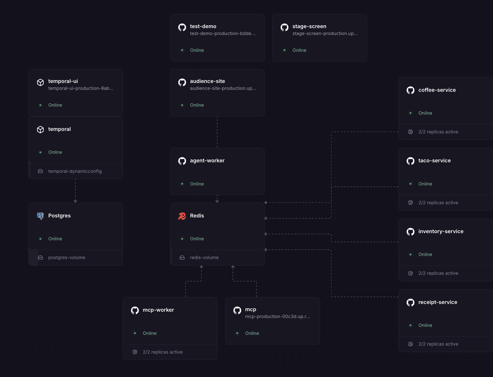

# Deploying the Demo to Railway

This guide puts the whole demo in one [Railway](https://railway.com) project:
a self-hosted Temporal server, a durable MCP server, four mock order services,
the audience board, a rehearsal console, an AI ordering agent and the projector
screen. Plan on about an hour, most of it setting variables.



> **About the live URLs in this guide.** The `*.up.railway.app` addresses below
> are the instances we ran on stage at AgntCon / MCPCon North America 2026.
> They are there to show you what a working deployment looks like, and **they
> will be taken down after the event.** Deploy your own copy to try it.

## What You're Building

A few terms first, if you haven't used these tools before:

- **Temporal** runs code as *durable workflows*. If a process crashes halfway
  through, Temporal replays the history and picks up where it left off instead
  of starting over. See [Temporal's docs](https://docs.temporal.io).
- **MCP** (Model Context Protocol) is how an AI agent discovers and calls
  tools on a server. See the [MCP spec](https://modelcontextprotocol.io).
- **Railway private networking** gives every service a hostname like
  `mcp.railway.internal` that only other services in the project can reach.
  See [Railway's networking docs](https://docs.railway.com/guides/private-networking).

The services, and how they talk to each other:

| Service | Repo | Public URL | What it does |
|---|---|---|---|
| `Postgres` | Railway template | no | Temporal's persistence and visibility store |
| `Redis` | Railway template | no | Every on/off switch, the board's state, MCP availability flags |
| `temporal` | `temporalio/auto-setup` image | no | Self-hosted Temporal server on `:7233` |
| `temporal-ui` | `temporalio/ui` image | yes | Temporal's web UI, for the on-stage timeline |
| `coffee-service`, `taco-service`, `inventory-service`, `receipt-service` | [service](https://github.com/iandouglas/temporal-agntcon-service) | no | The four mock APIs the tools call. One image, run four times |
| `mcp` | [mcp](https://github.com/iandouglas/temporal-agntcon-mcp) | yes | The MCP server. Every tool call starts a Temporal workflow |
| `mcp-worker` | [mcp](https://github.com/iandouglas/temporal-agntcon-mcp) | no | The Temporal worker that runs those tool-call workflows |
| `audience-site` | [audience](https://github.com/iandouglas/temporal-agntcon-audience) | yes | The phone UI the audience taps, and the operator panel |
| `test-demo` | [testdemo](https://github.com/iandouglas/temporal-agntcon-testdemo) | yes | The rehearsal console with the START THE DEMO button |
| `agent-worker` | [agntcon-mcpcon-demo](https://github.com/melienherrera/agntcon-mcpcon-demo) | no | The AI ordering agent's Temporal worker. The audience can kill it |
| `stage-screen` | [agntcon-mcpcon-demo](https://github.com/melienherrera/agntcon-mcpcon-demo) | yes | The projector view: workflow timeline, switches, order counts |

Our stage instances, until they come down after the event:

| Service | URL |
|---|---|
| audience board | https://audience-site-production.up.railway.app |
| MCP server | https://mcp-production-00c3d.up.railway.app/mcp (`/healthz` is public) |
| Temporal UI | https://temporal-ui-production-8ab0.up.railway.app |
| rehearsal console | https://test-demo-production-bdde.up.railway.app (needs `?key=`) |

## Before You Start

- A Railway account on a paid plan. Fifteen services with replicas is past
  what the free tier allows.
- An [Anthropic API key](https://console.anthropic.com) for the agent.
- Forks of the five GitHub repos above, so Railway can deploy from them.
- Optionally the [Railway CLI](https://docs.railway.com/guides/cli), for
  checking variables and logs.

Generate three random tokens now and keep them somewhere safe. They are
yours, nothing in these repos has them:

```bash
openssl rand -hex 24   # admin_token: board, MCP admin role, stage screen
openssl rand -hex 24   # agent token: what the AI agent sends to the MCP server
openssl rand -hex 24   # console token: the rehearsal console only
```

## Step 1: Create the Project and Its Data Stores

1. Create an empty project.
2. Add **Postgres** and **Redis** from Railway's templates. Both come with a
   volume.

## Step 2: Add Shared Variables

Project **Settings > Shared Variables**. Services reference these as
`${{shared.<name>}}`, so each value lives in one place.

| Shared variable | Value |
|---|---|
| `temporal_address` | `temporal.railway.internal:7233` |
| `temporal_namespace` | `default` |
| `temporal_task_queue` | `durable-mcp` |
| `admin_token` | your admin token |
| `mcp_agent_tokens` | `demo-agent:<your agent token>` (a comma-separated list of `label:token` pairs) |
| `service_1_name` ... `service_4_name` | `Order Taco`, `Order Coffee`, `Restock Inventory`, `Send Receipt` (we renamed coffee to `Order Churro` on stage) |
| `service_1_host` ... `service_4_host` | `http://taco-service.railway.internal:8080`, and the same for `coffee-service`, `inventory-service`, `receipt-service` |
| `service_1_path` ... `service_4_path` | `/taco`, `/coffee`, `/inventory`, `/receipt` |
| `service_1_description` ... `service_4_description` | One sentence each, e.g. "Place an order for a taco and wait until the kitchen confirms it." The agent reads these to decide what to call. The MCP repo's `.env.example` has all four |

The `service_N_name` values become the MCP tool names (`Order Taco` becomes
`order_taco`). The agent discovers them at runtime, so you can rename them
without touching code.

## Step 3: Temporal and Temporal UI

**`temporal`**: deploy the Docker image `temporalio/auto-setup:1.29.0`.

| Variable | Value |
|---|---|
| `DB` | `postgres12` |
| `DB_PORT` | `${{Postgres.PGPORT}}` |
| `POSTGRES_USER` | `${{Postgres.PGUSER}}` |
| `POSTGRES_PWD` | `${{Postgres.PGPASSWORD}}` |
| `POSTGRES_SEEDS` | `${{Postgres.PGHOST}}` |
| `DYNAMIC_CONFIG_FILE_PATH` | `config/dynamicconfig/development-sql.yaml` |

- Attach a volume (ours is `temporal-dynamicconfig`) at
  `/etc/temporal/config/dynamicconfig`. Railway can't mount a file from a repo,
  so the dynamic config file lives on a volume.
- No public domain. Everything reaches it over the private network at
  `temporal.railway.internal:7233`, with no TLS and no API key.
- `auto-setup` creates the `default` namespace on first boot. Visibility runs
  on Postgres too, which the stage screen needs to count orders.
- Give it more room than the rest: we ran it at 4 vCPU / 8 GB, everything else
  at 2 vCPU / 2 GB.

**`temporal-ui`**: deploy `temporalio/ui` with
`TEMPORAL_ADDRESS=temporal.railway.internal:7233`, and give it a public domain.

> **The Temporal UI has no login by default.** Anyone with its URL can see
> and terminate workflows. That was fine for a talk. For anything longer-lived,
> put auth in front of it ([Temporal UI auth docs](https://docs.temporal.io/references/web-ui-configuration#auth))
> or skip the public domain and use `railway connect`/port forwarding.

## Step 4: The Four Mock Services

Create four services from your fork of `temporal-agntcon-service`:
`taco-service`, `coffee-service`, `inventory-service`, `receipt-service`. The
service names matter, because they become the `.railway.internal` hostnames
in step 2.

| Variable | Value |
|---|---|
| `ENDPOINT` | `/taco`, `/coffee`, `/inventory` or `/receipt`. The only thing that differs between the four |
| `REDIS_URL` | `${{Redis.REDIS_PRIVATE_URL}}` |

- `railway.json` in the repo sets the Dockerfile build and the healthcheck.
- **The healthcheck must be `/ready`, never `/health`.** When the audience
  turns a service off, `/health` reflects it, Railway sees every replica fail,
  and restarts them all.
- We ran 2 replicas each. No public domains.

## Step 5: The MCP Server and Its Worker

Two services from your fork of `temporal-agntcon-mcp`, same variables on both:

- **`mcp`**: config file `railway.mcp.json`, start command `uv run durable-mcp`.
- **`mcp-worker`**: config file `railway.worker.json`, start command
  `uv run durable-mcp-worker`. We ran 2 replicas.

| Variable | Value |
|---|---|
| `service_N_url` (N = 1 to 4) | `${{shared.service_N_host}}${{shared.service_N_path}}` |
| `service_N_name`, `service_N_description` | `${{shared.service_N_name}}`, `${{shared.service_N_description}}` |
| `mcp_agent_tokens` | `${{shared.mcp_agent_tokens}}` |
| `admin_token` | `${{shared.admin_token}}` |
| `temporal_address`, `temporal_namespace`, `temporal_task_queue` | the matching `${{shared.*}}` |
| `redis_url` | `${{Redis.REDIS_URL}}` |

- `mcp` listens on **8080** (public: `/mcp`, `/healthz`) and **8081**
  (internal: `/admin/*`). When you add the public domain, **map it to port
  8080 only.** Railway's port picker offers 8081 too, and choosing it puts the
  admin controls on the internet. Check that `https://<your-domain>/admin/state`
  returns 404.
- Turn off app sleeping on both. A cold start mid-talk is dead air.
- Never set `allow_insecure` on Railway. It's for local work only.

## Step 6: The Audience Board

One service from your fork of `temporal-agntcon-audience`, with a public
domain. `railway.json` builds it with Nixpacks.

| Variable | Value |
|---|---|
| `admin_token` | `${{shared.admin_token}}` |
| `REDIS_URL` | `${{Redis.REDIS_URL}}` |
| `service_N_url` | `${{shared.service_N_host}}` (the base URL, no path) |
| `service_N_name` | `${{shared.service_N_name}}` |
| `mcp_url` | `http://mcp.railway.internal:8081` (the internal listener) |
| `mcp_admin_token` | `${{shared.admin_token}}` |

- Run **one replica**. Redis keeps it consistent if you add more, but one
  replica was enough for a room of phones.
- Node binds IPv6 with `BIND_HOST=::`, which is the default. Don't set it to
  `$HOSTNAME`.
- **The board ships locked.** Nothing the audience taps does anything until
  the operator opens the floor (step 7).

## Step 7: The Rehearsal Console

One service from your fork of `temporal-agntcon-testdemo`, with a public
domain. No build step: it's a single `node server.mjs`.

| Variable | Value |
|---|---|
| `AUDIENCE_URL` | the board's public URL, no trailing slash |
| `ADMIN_TOKEN` | `${{shared.admin_token}}` |
| `CONSOLE_TOKEN` | your console token. **Not** the admin token |
| `BIND_HOST` | `::` |

Open it at `https://<your-domain>/?key=<console token>`. The server refuses
to start on a public address without `CONSOLE_TOKEN`, and the admin token
never reaches the browser.

## Step 8: The Agent Worker and the Stage Screen

Two services from your fork of `agntcon-mcpcon-demo`, both with **Root
Directory `agent`**, both built from `agent/Dockerfile`. Melissa's
[DEPLOY.md](https://github.com/melienherrera/agntcon-mcpcon-demo/blob/main/DEPLOY.md)
has the detail.

**`agent-worker`**: start command `./scripts/run_worker.sh`, no public domain.

| Variable | Value |
|---|---|
| `TEMPORAL_ADDRESS`, `TEMPORAL_NAMESPACE` | `${{shared.temporal_address}}`, `${{shared.temporal_namespace}}` |
| `ANTHROPIC_API_KEY` | your key |
| `MCP_ENDPOINT` | `http://mcp.railway.internal:8080/mcp` |
| `MCP_AUTH_TOKEN` | your agent token (the part after `demo-agent:`) |
| `CHAOS_URL` | `http://audience-site.railway.internal:8080/chaos` |
| `CHAOS_COMPONENT` | `agent_worker` |
| `CHAOS_THRESHOLD` | `50` |

- Use `run_worker.sh`, not a bare `python -m` command. When the room votes
  the worker down, it exits hard, and the script won't restart it until
  someone fixes it on the board. Railway would restart a bare process at
  once, and the kill would mean nothing.
- Don't set `temporal_task_queue` here. The agent uses its own queue,
  `richards-agent`.

**`stage-screen`**: start command `./scripts/run_stage.sh`, public domain.

| Variable | Value |
|---|---|
| `TEMPORAL_ADDRESS`, `TEMPORAL_NAMESPACE` | the same shared references |
| `BOARD_URL` | `http://audience-site.railway.internal:8080` |
| `BOARD_ADMIN_TOKEN` | `${{shared.admin_token}}` |
| `STAGE_ADMIN_TOKEN` | `${{shared.admin_token}}` |
| `STAGE_COMPONENTS` | `all` |

- `run_stage.sh` binds `0.0.0.0` and Railway's `$PORT`. A bare `uvicorn`
  binds `127.0.0.1`, which deploys green and then returns 502 on every request.
- Open the screen once as `https://<your-domain>/?token=<admin token>`. The
  page keeps the token for that tab and removes it from the address bar.
  Placing and stopping orders need it.

## Step 9: Check It Works

1. `https://<mcp-domain>/healthz` lists four tools, and `/admin/state` on the
   same domain returns 404.
2. The board loads on a phone, and the operator panel at
   `/control?token=<admin token>` shows all switches.
3. The console's START THE DEMO opens the floor. Tap a switch on your phone
   and watch it move on the board.
4. `agent-worker`'s logs say `watchdog armed`. If they say
   `CHAOS_URL unset; watchdog DISABLED`, the room can't kill it.
5. On the stage screen, place one order. It shows up in the Temporal UI on
   the `richards-agent` queue, and the left pane lists six components.
6. Turn `taco-service` off from the board while an order is running. The tool
   call doesn't fail, it waits. Turn it back on and the order finishes.

## Things That Bit Us

- **Private URLs need a port.** `.railway.internal` has no default, so it's
  always `http://<service>.railway.internal:8080`. The private network only
  exists at runtime, so a build step can't reach it.
- **Railway's proxy cuts requests at 15 minutes.** The MCP server caps a tool
  call's wait at 840s, so clients need a timeout above 15 minutes. The agent
  uses 960s and calls the private URL, which avoids the proxy altogether.
- **MCP clients must send `MCP-Protocol-Version: 2026-07-28`.** Without it
  the server falls back to the legacy transport, which has no keepalive, and
  the call dies at about 5 minutes. The MCP repo's README has the rest of the
  client contract.
- **Tool names come from variables.** Renaming a switch on the board changes
  its label, not its tool. Join board switches to tools by their number `N`.
- **If the stage screen's order count sticks at 0** while orders are clearly
  finishing, look for `order count query failed` in its logs. It's a
  visibility query, not a broken demo.

## After the Talk

Change all three tokens, revoke the Anthropic key you used, and delete the
project or at least the public domains. A demo with a public "break the
service" button shouldn't outlive its audience.
